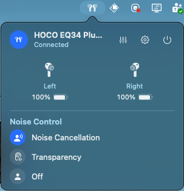
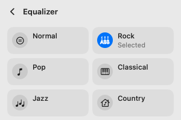
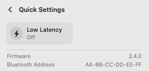

<p align="center">
  
</p>

<h1 align="center">AirBuds</h1>

<p align="center">
  Battery, noise control and EQ for your Hoco earbuds, right in the Mac menu bar.<br>
  Native Swift and SwiftUI · macOS 13+ · Apple Silicon and Intel
</p>

<p align="center">
  <a href="../../releases/latest"><b>Download</b></a> ·
  <a href="#install">Install</a> ·
  <a href="#using-airbuds">Using AirBuds</a> ·
  <a href="#build-from-source">Build from source</a> ·
  <a href="docs/ARCHITECTURE.md">How it works</a>
</p>

<p align="center">
  
</p>

## Why

Hoco earbuds work fine on a Mac for audio, but there's no way to see each
bud's battery, switch noise cancellation or change the EQ without reaching for
your phone. AirBuds adds those controls to the menu bar, in a panel styled like
the AirPods menu.

It talks to the earbuds directly over Bluetooth. No account, no internet, no
telemetry.

## Features

- **Battery** for the left bud, right bud and case, with optional battery text in the menu bar
- **Low battery alerts** at 20% and again at 10%, without repeats
- **Noise control**: Noise Cancellation, Transparency or Off
- **EQ presets**: Normal, Rock, Pop, Classical, Jazz and Country
- **Low Latency** (game mode)
- **Device info**: firmware version and Bluetooth address
- **Open at Login**, light and dark mode, and your system accent color

AirBuds only shows the controls your earbuds say they support. On a model
without ANC, for example, the noise control section doesn't appear.

## Supported earbuds

Hoco earbuds built on Jieli chips, which covers most of the range.

| Model | Status |
| --- | --- |
| HOCO EQ34 Plus ANC (firmware 2.4.0) | Tested |
| Other Hoco models | Should work, not yet tested |

If your model doesn't connect or something looks wrong, run AirBuds with
`AIRBUDS_DEBUG=1` (see [Development](#development)) and open an issue with the log.

## Install

1. Download **AirBuds-x.y.z.dmg** from the [latest release](../../releases/latest),
   open it and drag **AirBuds** into **Applications**.
2. Open AirBuds. It's ad-hoc signed but not notarized by Apple, so macOS blocks
   the first launch. Go to **System Settings → Privacy & Security** and click
   **Open Anyway**, or run:
   ```bash
   xattr -dr com.apple.quarantine "/Applications/AirBuds.app"
   ```
3. Click **Allow** when macOS asks for Bluetooth access.

To verify a download, compare `shasum -a 256 AirBuds-*.dmg` with
`SHA256SUMS.txt` on the release page.

The first launch from Applications turns on **Open at Login**. You can turn it
off from the right-click menu.

## Using AirBuds

1. Pair your earbuds in **System Settings → Bluetooth** and connect them as usual.
2. Click the **earbuds icon** in the menu bar. AirBuds finds them within a few seconds.

| | |
| --- | --- |
|  | **Main panel**<br>Battery for each bud and the case (shown when the earbuds report it). Click a noise mode to switch.<br><br>Buttons at the top right: **Equalizer**, **Quick Settings** and **Quit**. |
|  | **Equalizer**<br>Click a preset to apply it. |
|  | **Quick Settings**<br>Turn **Low Latency** on or off, and see the firmware version and Bluetooth address. |

**Right-click the menu bar icon** for:

- **Open at Login**
- **Battery in Menu Bar**: Icon Only, Left · Right, Average or Lowest
- **Low Battery Alerts**: on by default. macOS asks for notification permission the first time your earbuds connect.
- **Quit**

**Tips**

- Changes made with the buttons on the earbuds show up in the panel by themselves.
- A spinner means the earbuds haven't confirmed a change yet. That control
  ignores clicks until they do, or for at most 4 seconds.
- The earbuds accept one controller at a time. If AirBuds keeps trying to
  connect, close any earbuds app on your phone.
- **Esc** returns to the main panel.

## Build from source

You need macOS 13 or later, plus Xcode or just the Command Line Tools
(`xcode-select --install`).

```bash
scripts/build-app.sh                 # build/AirBuds.app for this Mac's chip
scripts/build-app.sh --install       # …and copy it to /Applications
scripts/build-app.sh --universal     # arm64 + x86_64 (needs the Xcode license accepted)
scripts/make-dmg.sh 0.1.0            # DMG, zip and SHA256SUMS.txt in dist/
```

You can also open `Package.swift` in Xcode, pick the **AirBuds** scheme and press Run.

### Development

```bash
swift run AirBudsKitChecks                            # protocol self-checks
AIRBUDS_DEBUG=1 swift run AirBuds                     # log every packet to and from the earbuds
AIRBUDS_OPEN=1 swift run AirBuds                      # open the panel on launch
AIRBUDS_SNAPSHOT=docs/screenshots swift run AirBuds   # regenerate the screenshots (debug builds)
AIRBUDS_FAKE_LOW_BATTERY=1 swift run AirBuds          # fake low battery to test alerts (debug builds, inside an .app)
```

### Releasing

Push a version tag and GitHub Actions
([`release.yml`](.github/workflows/release.yml)) runs the checks, builds a
universal app, packages a DMG and zip with checksums, and publishes the release:

```bash
git tag v0.2.0
git push origin v0.2.0
```

You can also start it by hand from the **Actions** tab (Release → Run workflow).

## Project layout

```
Sources/AirBudsKit/        Earbud protocol: handshake, framing, codecs, capabilities
Sources/AirBuds/           Menu bar app: BLE transport, device state, SwiftUI panel
Sources/AirBudsKitChecks/  Protocol self-checks
Resources/                 Info.plist and app icon
scripts/                   build-app.sh, make-dmg.sh
docs/                      Architecture, protocol, screenshots
.github/workflows/         CI and release
```

More detail:

- [Architecture](docs/ARCHITECTURE.md): modules, how a connection comes up, how setting changes are confirmed
- [Earbud protocol](docs/PROTOCOL.md): the Jieli handshake, frame format and every command AirBuds uses

## Credits

- The handshake uses the cipher from Jieli's own SDK (`jl_auth`). The
  [MOONDROP Pudding control plugin](https://github.com/maxlen727/MOONDROP-PUDDING-dux-shell-plugin)
  documents the handshake sequence. The battery, noise control, EQ and
  low latency commands were worked out on a HOCO EQ34 Plus ANC.

## License

MIT. See [LICENSE](LICENSE).

AirBuds is an unofficial project, not affiliated with or endorsed by Hoco or
Zhuhai Jieli Technology. "Hoco" is a trademark of its owner.
