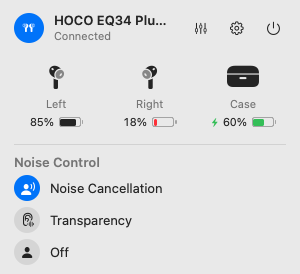
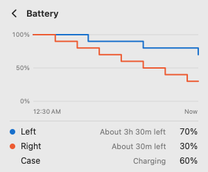
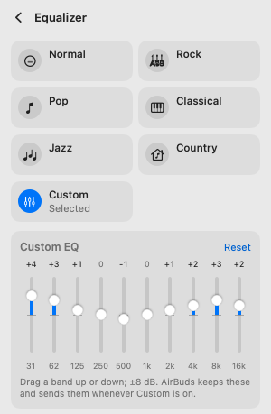
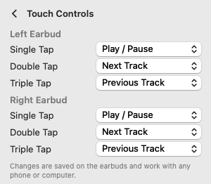
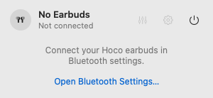
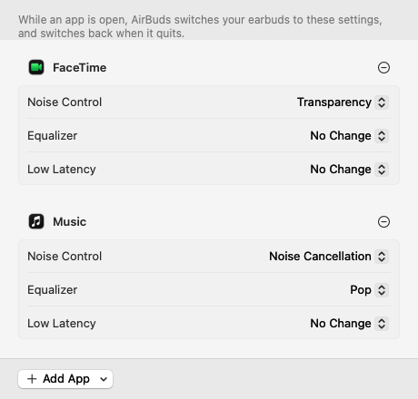

<p align="center">
  
</p>

<h1 align="center">AirBuds</h1>

<p align="center">
  Battery, noise control and EQ for your Hoco earbuds, right in the Mac menu bar.<br>
  Native Swift and SwiftUI · macOS 13+ · Apple Silicon and Intel
</p>

<p align="center">
  <a href="../../releases/latest"><b>Download</b></a> ·
  <a href="#install">Install</a> ·
  <a href="#using-airbuds">Using AirBuds</a> ·
  <a href="#build-from-source">Build from source</a> ·
  <a href="docs/ARCHITECTURE.md">How it works</a>
</p>

<p align="center">
  
</p>

## Why

Hoco earbuds work fine on a Mac for audio, but there's no way to see each
bud's battery, switch noise cancellation or change the EQ without reaching for
your phone. AirBuds adds those controls to the menu bar, in a panel styled like
the AirPods menu.

It talks to the earbuds directly over Bluetooth. No account, no internet, no
telemetry.

## Features

- **Battery** for the left bud, right bud and case, with optional battery text in the menu bar
- **Time left** estimate and a **battery chart** of your current listening session
- **Low battery alerts** at 20% and again at 10%, without repeats, and **fully charged** alerts
- **Noise control**: Noise Cancellation, Transparency or Off, with the current mode shown in the menu bar
- **Keyboard shortcut**: ⌃⌥N switches the noise mode from any app
- **EQ presets**: Normal, Rock, Pop, Classical, Jazz and Country, plus a **10-band Custom EQ**
- **Touch controls**: choose what single, double and triple tap do on each bud
- **Low Latency** (game mode)
- **Automations**: switch noise control, EQ or Low Latency while particular apps are open
- **`airbuds://` links** for the Shortcuts app, scripts and Terminal
- **Rename** your earbuds
- **Connect and disconnect** from the panel, without opening Bluetooth settings
- **Automatic updates** through Sparkle
- **Device info**: firmware version and Bluetooth address
- **Open at Login**, light and dark mode, and your system accent color

AirBuds only shows the controls your earbuds say they support. On a model
without ANC, for example, the noise control section doesn't appear.

## Supported earbuds

Hoco earbuds built on Jieli chips, which covers most of the range.

| Model | Status |
| --- | --- |
| HOCO EQ34 Plus ANC (firmware 2.4.0) | Tested |
| Other Hoco models | Should work, not yet tested |

If your model doesn't connect or something looks wrong, run AirBuds with
`AIRBUDS_DEBUG=1` (see [Development](#development)) and open an issue with the log.

## Install

1. Download **AirBuds-x.y.z.dmg** from the [latest release](../../releases/latest),
   open it and drag **AirBuds** into **Applications**.
2. Open AirBuds. It's ad-hoc signed but not notarized by Apple, so macOS blocks
   the first launch. Go to **System Settings → Privacy & Security** and click
   **Open Anyway**, or run:
   ```bash
   xattr -dr com.apple.quarantine "/Applications/AirBuds.app"
   ```
3. Click **Allow** when macOS asks for Bluetooth access.

To verify a download, compare `shasum -a 256 AirBuds-*.dmg` with
`SHA256SUMS.txt` on the release page.

The first launch from Applications turns on **Open at Login**. You can turn it
off from the right-click menu.

## Using AirBuds

1. Pair your earbuds in **System Settings → Bluetooth** and connect them as usual.
2. Click the **earbuds icon** in the menu bar. AirBuds finds them within a few seconds.

| | |
| --- | --- |
|  | **Main panel**<br>Battery for each bud and the case (shown when the earbuds report it), and how long until the first bud runs out. Click a noise mode to switch.<br><br>Buttons at the top right: **Equalizer**, **Quick Settings** and **Quit**. |
|  | **Battery**<br>Click the battery row. The chart shows each bud's level since you started listening; hover it for the exact reading. Below it, time left for each bud. |
|  | **Equalizer**<br>Click a preset to apply it, or **Custom** to shape the sound yourself: drag each of the 10 bands (31 Hz to 16 kHz) up or down by up to 8 dB. |
|  | **Touch Controls**<br>From Quick Settings. Pick what single, double and triple tap do on each bud: play/pause, next or previous track, volume, calls, or switching the noise mode. Saved on the earbuds. |
|  | **Quick Settings**<br>Turn **Low Latency** on or off, open **Automations**, **Disconnect** the earbuds, and see the firmware version and Bluetooth address. Click the pencil next to the name to **rename** them. |
|  | **Not connected**<br>Your paired Hoco earbuds are listed. Click one to **connect** it to this Mac. |

**Right-click the menu bar icon** for:

- **Open at Login**
- **Battery in Menu Bar**: Icon Only, Left · Right, Average or Lowest
- **Noise Mode in Menu Bar**: on by default. Shows the Noise Cancellation or Transparency symbol next to the icon.
- **Low Battery Alerts**: on by default. macOS asks for notification permission the first time your earbuds connect.
- **Fully Charged Alerts**: on by default. Notifies when a bud or the case reaches 100% while charging.
- **Noise Control Shortcut (⌃⌥N)**: on by default.
- **Automations…**
- **Check for Updates…**: AirBuds also checks once a day by itself.
- **Quit**

**Keyboard shortcut**

Press **⌃⌥N** (Control-Option-N) in any app to step through Noise
Cancellation → Transparency → Off. A small indicator under the menu bar icon
shows the new mode. No Accessibility permission is needed. If another app
already uses ⌃⌥N, AirBuds leaves it alone, and the menu item's tooltip says so.

**Automations**



Pick an app and what your earbuds should do while it's open: for example
Transparency for FaceTime or Zoom, Low Latency for a game, or the Pop preset for
Music. When the app quits, AirBuds switches back to what you had before, unless
you changed it yourself in the meantime. If several of these apps are open, the
one opened last wins.

**Links and the Shortcuts app**

AirBuds handles `airbuds://` links, so you can control it from the Shortcuts
app (the **Open URLs** action), a script, or Terminal:

| Link | Does |
| --- | --- |
| `airbuds://noise/anc` | Noise Cancellation |
| `airbuds://noise/transparency` | Transparency |
| `airbuds://noise/off` | Noise control off |
| `airbuds://noise/next` | Next noise mode, like ⌃⌥N |
| `airbuds://eq/rock` | EQ preset, by name or number (`normal`, `pop`, `3`, …) |
| `airbuds://low-latency/on` | Low Latency `on`, `off` or `toggle` |
| `airbuds://connect` | Connect your paired earbuds |
| `airbuds://disconnect` | Disconnect them |
| `airbuds://open` | Open the panel |

```bash
open "airbuds://noise/transparency"
```

A link that launches AirBuds waits up to 20 seconds for the earbuds to connect.

**Tips**

- Changes made with the buttons on the earbuds show up in the panel by themselves.
- A new name is saved on the earbuds right away (up to 20 bytes). Other
  devices, and the Bluetooth list on this Mac, show it after the earbuds
  restart: put them in the case and take them out again. AirBuds keeps
  recognising them under the new name.
- The time-left estimate appears after the battery has dropped a couple of
  times, since some earbuds only report in 10% steps. Battery history stays on
  your Mac (`~/Library/Application Support/AirBuds/`) and keeps the last 7 days.
- A spinner means the earbuds haven't confirmed a change yet. That control
  ignores clicks until they do, or for at most 4 seconds.
- The earbuds accept one controller at a time. If AirBuds keeps trying to
  connect, close any earbuds app on your phone.
- **Esc** returns to the main panel.

## Build from source

You need macOS 13 or later, plus Xcode or just the Command Line Tools
(`xcode-select --install`).

```bash
scripts/build-app.sh                 # build/AirBuds.app for this Mac's chip
scripts/build-app.sh --install       # …and copy it to /Applications
scripts/build-app.sh --universal     # arm64 + x86_64 (needs the Xcode license accepted)
scripts/make-dmg.sh 0.1.0            # DMG, zip and SHA256SUMS.txt in dist/
```

You can also open `Package.swift` in Xcode, pick the **AirBuds** scheme and press Run.

### Development

```bash
swift run AirBudsKitChecks                            # self-checks: protocol, battery, automations, links
AIRBUDS_DEBUG=1 swift run AirBuds                     # log every packet to and from the earbuds
AIRBUDS_OPEN=1 swift run AirBuds                      # open the panel on launch
AIRBUDS_SNAPSHOT=docs/screenshots swift run AirBuds   # regenerate the screenshots (debug builds)
AIRBUDS_FAKE_LOW_BATTERY=1 swift run AirBuds          # fake low battery to test alerts (debug builds, inside an .app)
AIRBUDS_DEBUG=1 AIRBUDS_SEND="c1 ffffffff; 07 ff ffffffff" swift run AirBuds
                                                      # send raw RCSP commands after connecting (debug builds)
```

`AIRBUDS_SEND` is for reverse engineering: each `;`-separated command is an
opcode followed by its parameters in hex, sent a second apart. With
`AIRBUDS_DEBUG=1` every reply and push is printed decoded. Prefer reads (`07`,
`c1`); see [PROTOCOL.md](docs/PROTOCOL.md) before sending anything that writes.

### Releasing

Push a version tag and GitHub Actions
([`release.yml`](.github/workflows/release.yml)) runs the checks, builds a
universal app, packages a DMG and zip with checksums, and publishes the release:

```bash
git tag v0.2.0
git push origin v0.2.0
```

You can also start it by hand from the **Actions** tab (Release → Run workflow).

#### Automatic updates (Sparkle)

Each release also publishes `appcast.xml`, the feed installed copies check
(`SUFeedURL` in `Info.plist` points at the latest release's copy). The feed and
the zip are signed with an EdDSA key whose public half is `SUPublicEDKey` in
`Info.plist`. The private half lives in the maintainer's login keychain, and
CI needs it as the repository secret `SPARKLE_PRIVATE_KEY`. One-time setup:

```bash
swift package resolve
.build/artifacts/sparkle/Sparkle/bin/generate_keys -x sparkle-private.key   # export from the keychain
# GitHub → Settings → Secrets and variables → Actions → New secret:
#   name SPARKLE_PRIVATE_KEY, value: the file's contents
rm -P sparkle-private.key
```

Keep the key safe: without it you can't ship updates to existing installs.
Without the secret, releases still publish but skip `appcast.xml`, so installed
copies aren't told about them. To try the feed locally, `scripts/make-appcast.sh
<version> <build>` signs with the key in your keychain.

## Project layout

```
Sources/AirBudsKit/        Earbud protocol, plus battery, automation and link logic (no UI)
Sources/AirBuds/           Menu bar app: BLE transport, device state, SwiftUI panel
Sources/AirBudsKitChecks/  Self-checks for AirBudsKit
Resources/                 Info.plist and app icon
scripts/                   build-app.sh, make-dmg.sh, make-appcast.sh
docs/                      Architecture, protocol, screenshots
.github/workflows/         CI and release
```

More detail:

- [Architecture](docs/ARCHITECTURE.md): modules, how a connection comes up, how setting changes are confirmed
- [Earbud protocol](docs/PROTOCOL.md): the Jieli handshake, frame format and every command AirBuds uses
- [Roadmap](docs/ROADMAP.md): ideas for what to add next

## Credits

- Updates by [Sparkle](https://sparkle-project.org) (MIT).
- The handshake uses the cipher from Jieli's own SDK (`jl_auth`). The
  [MOONDROP Pudding control plugin](https://github.com/maxlen727/MOONDROP-PUDDING-dux-shell-plugin)
  documents the handshake sequence. The battery, noise control, EQ and
  low latency commands were worked out on a HOCO EQ34 Plus ANC.

## License

MIT. See [LICENSE](LICENSE).

AirBuds is an unofficial project, not affiliated with or endorsed by Hoco or
Zhuhai Jieli Technology. "Hoco" is a trademark of its owner.
