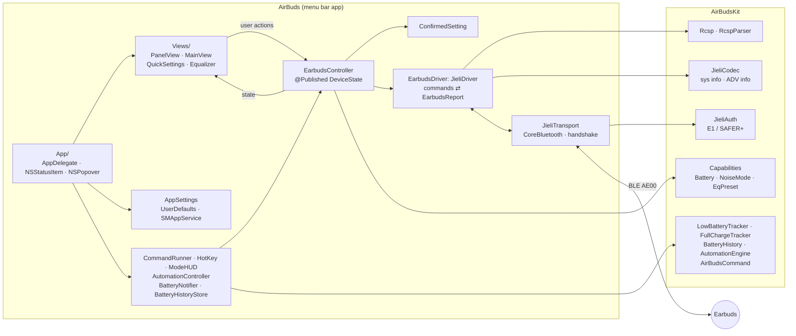
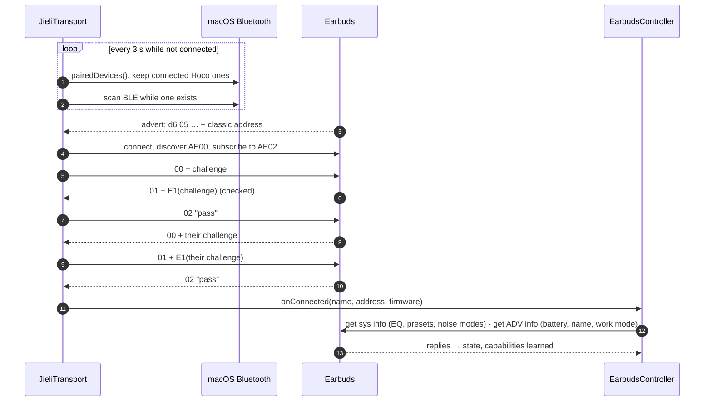
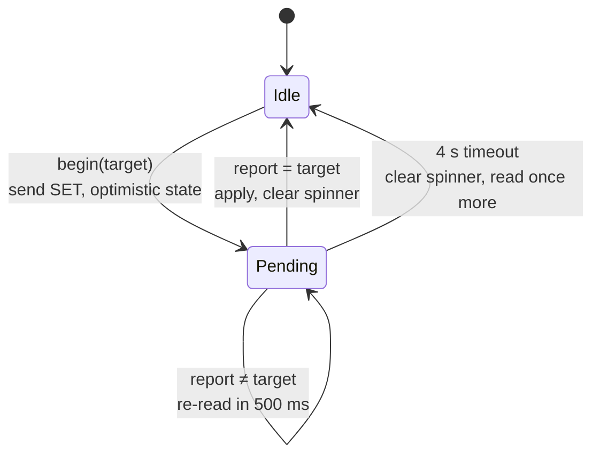
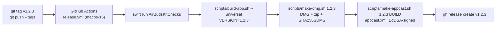

# Architecture

AirBuds is a single native process: an AppKit status item that hosts a SwiftUI
panel, talking to Hoco earbuds over BLE through CoreBluetooth. There is no
helper process, no web view and no network access.

## Modules

The Swift package has three targets.

| Target | Kind | What it does |
| --- | --- | --- |
| `AirBudsKit` | library | The earbud protocol (Jieli RCSP): handshake cipher, packet framing, payload encoders and decoders, and capabilities. Also the app's decision logic: battery alerts, battery history and time left, per-app automation, and `airbuds://` link parsing. Pure Swift with no UI or Bluetooth, so it's easy to test. |
| `AirBuds` | app | BLE transport, device state, settings and the SwiftUI panel. |
| `AirBudsKitChecks` | tool | Self-checks for `AirBudsKit` (`swift run AirBudsKitChecks`): protocol checks built on bytes captured from real earbuds, plus the battery, automation and link logic. |



## Source map

Folders follow the layers above. Everything that belongs to one earbud protocol
sits under a `Protocols/<name>/` (pure codecs, in AirBudsKit) or `Drivers/<name>/`
(Bluetooth and session, in the app) folder, so a new brand gets one folder in
each. `EarbudsController` only sees the `EarbudsDriver` protocol and
`EarbudsReport`, never a brand's own types.

```
Sources/AirBudsKit/
  Models/
    Models.swift             Battery, NoiseMode (and cycling order), EqPreset (and the standard six),
                             Capabilities (and name rules)
    EarbudsReport.swift      A reply or update in brand-neutral terms; every driver produces these
    Controls.swift           Touch controls and custom EQ values (Jieli's numbering, for now)
  Logic/
    LowBattery.swift         When to alert: 20% / 10% thresholds, re-arm after charging
    FullCharge.swift         When to say "fully charged": reaching 100% after charging below it
    BatteryHistory.swift     Battery samples, sessions and the time-left estimate
    Automation.swift         Per-app rules and the engine that applies and restores them
    Commands.swift           airbuds:// link parsing
    AudioOutput.swift        Which CoreAudio output is the earbuds (by address), and the volume symbol
  Protocols/Jieli/
    Rcsp.swift               RCSP framing and parser (with an overview of the protocol)
    JieliAuth.swift          Handshake (E1/SAFER+)
    JieliCodec.swift         Payload encoders and decoders (sys info, ADV info)
    Capabilities+Jieli.swift Capability learning from Jieli reports; which devices are Jieli
    JieliReport.swift        Jieli sys info and ADV info as EarbudsReport
Sources/AirBuds/
  App/
    main.swift               Entry point
    AppDelegate.swift        Status item, popover, right-click menu, link handling
    AppSettings.swift        Menu bar options, alerts, shortcut, automation rules, Open at Login
    MenuBarIcon.swift        The menu bar icon (SF "earbuds" symbol), with the noise mode beside it
    ModeHUD.swift            The on-screen indicator under the menu bar icon
    Updater.swift            Sparkle auto-update and "Check for Updates…"
  Bluetooth/                 Brand-neutral classic Bluetooth
    ClassicConnection.swift  Connects and disconnects paired earbuds for audio (IOBluetooth)
    PairedEarbuds.swift      A paired device as the panel lists it
    KnownEarbuds.swift       Earbuds remembered by address, so renamed ones are still found
  Drivers/
    EarbudsDriver.swift      The interface every brand implements: start/stop, reads, settings,
                             and callbacks for connect, disconnect, reports and paired devices
    Jieli/
      JieliTransport.swift   Finds the BLE side of the connected buds, connects, runs the handshake,
                             relays bytes; lists paired earbuds
      JieliDriver.swift      EarbudsDriver for Jieli: encodes reads and settings, decodes replies
                             and pushed updates, learns capabilities
  Device/
    EarbudsController.swift  All device state and every setter
    DeviceState.swift        Plain value types the UI renders
    ConfirmedSetting.swift   "Wait until the buds confirm" helper
  Features/
    Battery/                 BatteryNotifier (low battery and fully charged notifications),
                             BatteryHistoryStore (samples per device, saved to Application Support)
    Automation/              AutomationController: watches apps and applies automation rules
    Volume/                  EarbudsVolume: the earbuds' output volume and mute through CoreAudio
    Shortcuts/               CommandRunner (shortcut and airbuds:// links, waits for the buds),
                             HotKey (system-wide shortcut through Carbon's RegisterEventHotKey)
  Views/
    Panel/                   One file per panel page (Main, Battery, Equalizer with Custom EQ,
                             Quick Settings, Touch Controls) and PanelView, which switches them
    Automations/             The Automations window
    Components.swift         Building blocks shared by the pages and the indicator
  Support/
    Log.swift                Console logging; AIRBUDS_DEBUG=1 logs every packet
    Timers.swift             Delayed and TimerBag one-shot timers
  Debug/
    DebugSnapshots.swift     Debug only: renders every page to PNG (used for docs/screenshots)
Sources/AirBudsKitChecks/
  main.swift                 Runs every check and prints the totals
  Harness.swift              section, check and hex helpers
  BatteryChecks.swift  CommandChecks.swift  AutomationChecks.swift  VolumeChecks.swift
  Protocols/JieliChecks.swift  Protocol checks on bytes captured from real earbuds
```

## Adding a brand

1. **Protocol** in `Sources/AirBudsKit/Protocols/<Brand>/`: framing, payload
   encoders and decoders, a conversion to `EarbudsReport`, and capability
   learning. No Bluetooth here, so it can be checked on captured bytes.
2. **Checks** in `Sources/AirBudsKitChecks/Protocols/<Brand>Checks.swift`, called
   from `main.swift`.
3. **Driver** in `Sources/AirBuds/Drivers/<Brand>/`: a class that implements
   `EarbudsDriver`, plus its transport (BLE, or RFCOMM through IOBluetooth).
4. **Pick it**: today `EarbudsController(driver:)` gets `JieliDriver()` by
   default. With a second brand, a small registry that asks each driver whether
   it supports a paired device would choose instead, and device discovery
   (now inside `JieliTransport`) would move to `Bluetooth/` so drivers share it.

Still in Jieli's terms, to revisit when a second brand needs it: EQ preset ids
(`EqPreset.standard`), the Custom EQ slot (`CustomEq.id`, mode 6) and touch
function numbers (`TouchFunction`). A driver maps its own values to these.

## How a connection comes up

Hoco earbuds play audio over classic Bluetooth, but take control commands over
BLE. Every 3 seconds, and right away on an IOBluetooth connect notification,
`JieliTransport` checks for a supported paired classic device that is
connected. Only then does it scan BLE, so the app never scans otherwise.

A device is supported if its name contains "hoco" or it passed the handshake
before (`KnownEarbuds`, by address, in UserDefaults), so renamed earbuds are
still found. It counts as connected if `IOBluetoothDevice.isConnected()` says
so or a connect notification arrived with no disconnect notification since.
The notifications matter: in a long-running process `isConnected()` can stay
`false` after a reconnect, which left the panel stuck on "Not connected" after
Disconnect and Connect. When the classic connection goes away, the transport
drops the BLE link too.



Firmware comes from the classic device's Device ID (PnP) SDP record. If a
connection or handshake fails 3 times, the transport stops trying for that
device until it reconnects for audio.

**Connect and Disconnect** in the panel go through `ClassicConnection`:
`IOBluetoothDevice.openConnection(_:)` (asynchronous, reports to
`connectionComplete(_:status:)`) and `closeConnection()`, like the buttons in
System Settings. Disconnect closes the BLE link first. After a connect, the
normal flow above opens the control link.

## Capabilities come from the earbuds

`Capabilities` starts empty. The first replies fill it in: the noise modes the
earbuds list (attribute `0E`) turn on Noise Control and Transparency, an EQ
report turns on the preset list, and a work mode report turns on Low Latency.
A Hoco model without ANC simply never shows the Noise Control section.

## How a setting change works

The earbuds sometimes report the old value for a moment after a change. Each
setting is wrapped in a `ConfirmedSetting`, which makes the UI respond
instantly and then waits for the earbuds to agree:

1. The UI calls a setter, e.g. `setNoiseMode(.transparency)`.
2. The controller sends the set command, updates state optimistically and
   marks it **pending**. The UI shows a spinner and ignores further taps on that control.
3. After 400 ms it reads the value back. Reports that don't match the target are
   ignored, and it asks again every 500 ms. The earbuds also push a `09` update
   when a value changes, including from a button press on the buds.
4. A matching report clears the pending flag. If no match arrives within 4 s,
   the pending flag is dropped and the next report is trusted.



Battery is read on connect, every 60 seconds, whenever the panel opens, and
whenever the earbuds push a status beacon (`C2`).

## Low battery alerts

`LowBatteryNotifier` watches battery reports and asks `LowBatteryTracker`
(in AirBudsKit, covered by the self-checks) whether to alert. Each part (left,
right, case) alerts once at 20% and once at 10%. It re-arms after charging, or
once the level is back 5+ points above the last alert, so a battery hovering at
19–21% never spams you. Parts that cross a threshold in the same report share
one notification. Permission is requested the first time earbuds connect, not
at launch.

## Battery history and time left

`BatteryHistoryStore` records a sample whenever the battery changes, plus a
heartbeat every 5 minutes while connected, one history per earbuds address. A
gap of more than 15 minutes ends a session. It saves to
`~/Library/Application Support/AirBuds/battery-history.json` 30 seconds after a
change and on quit, and drops samples older than 7 days.

Time left uses the trailing discharge of the current session (no charging, level
never rising) and needs at least two level drops 5+ minutes apart. The rate is
measured from the first drop to the last, not from when a level was first seen,
because some earbuds report in 10% steps. If the next drop is overdue, the rate
is slowed to match. The main panel shows the bud that runs out first.

## Fully charged alerts

`FullChargeTracker` alerts when a part reaches 100% after being seen charging
below 100%, so connecting buds that are already full stays quiet. Some firmware
clears the charging flag at 100%, so a full report counts either way. Charging
that stops short of 100% disarms that part.

## Keyboard shortcut, links and the indicator

`HotKey` registers ⌃⌥N with Carbon's `RegisterEventHotKey`, which works in any
app without Accessibility permission. `airbuds://` links arrive through
`application(_:open:)` and are parsed into an `AirBudsCommand`. Both go through
`CommandRunner`, which applies the change and shows `ModeHUD`, a non-activating
panel under the status item that fades out after a moment.

A link can launch the app before the earbuds are ready. `CommandRunner` then
retries on each state change for up to 20 seconds. Missing capabilities count as
missing only after the first reads come back, so a model without ANC gets
"Not Available" and not an endless wait.

## Automations

Rules live in `AppSettings` (JSON in UserDefaults). `AutomationController`
re-evaluates whenever an app launches or quits, the rules change, or the earbuds
report. It passes running apps (oldest first) and the current settings to
`AutomationEngine`, which returns only the changes to send:

- For each setting, the newest running app whose rule sets it wins.
- When a rule first takes a setting over, the engine remembers the old value.
- When no rule controls it any more, it restores that value, but only if the
  setting still has the value the rule set. A manual change in between is kept.
- Nothing is sent until the earbuds have reported that setting. On disconnect
  the engine resets, so rules for apps still open apply again on reconnect.

## UI

- `NSStatusItem` shows the earbuds icon (a template image), optionally with the
  noise mode symbol beside it and battery text. Left click toggles an
  `NSPopover`; right click shows the app menu.
- The popover hosts `PanelView` in an `NSHostingController` with
  `sizingOptions = .preferredContentSize`, so its height follows the content.
- `PanelNavigation.page` drives the sub-pages, which slide in from the right.
  Esc goes back, and closing the popover always returns to the main page.
- Views use a tiny `Local<T>` observable instead of `@State`. In the current
  SDK `@State` is a macro whose compiler plugin ships only with Xcode, and this
  keeps the project buildable with just the Command Line Tools.

## Build and release



`build-app.sh` runs `swift build -c release`, assembles the `.app` (binary,
Info.plist, icon, and `Sparkle.framework` in `Contents/Frameworks`) and ad-hoc
signs it. Sparkle keeps the Sparkle project's own signature; the binary finds
it through an `@executable_path/../Frameworks` rpath set in `Package.swift`. Info.plist is also linked into the
executable's `__TEXT,__info_plist` section, so a bare `swift run` (or Run in
Xcode) has the Bluetooth usage string too. Without it, macOS terminates the
process on first Bluetooth access.

## Updates

Sparkle 2 (Swift package, prebuilt framework) checks
`https://github.com/abdullahmia/airbuds/releases/latest/download/appcast.xml`
daily and from **Check for Updates…**. `release.yml` writes that feed with
`scripts/make-appcast.sh`: one item pointing at the release's zip, with the
build number (`CFBundleVersion`, the workflow's run number) Sparkle compares
and an EdDSA signature from the `SPARKLE_PRIVATE_KEY` secret. Installed copies
check it against `SUPublicEDKey` in Info.plist. That signature is what makes
updates safe without a Developer ID. Sparkle also clears the quarantine flag on
what it installs, so updated copies open without the Gatekeeper prompt.

Tested end to end with a local feed: an installed 0.1.0 downloaded 0.9.0,
verified it, and replaced itself on quit, still validly signed and not
quarantined. `Updater` only starts inside an app bundle with a feed URL and
public key, so `swift run` doesn't try to update.

## Touch controls and custom EQ

- **Touch controls** are read with the other ADV info (attribute `02`). A change
  sends one `[bud, gesture, function]` entry and is confirmed like other
  settings: `ConfirmedSetting` waits for a report that contains the new entry.
- **Custom EQ** gains live in `EqState.customGains`, saved per earbuds address
  in UserDefaults and seeded from the earbuds' Custom slot. Slider moves update
  the state at once and are sent 120 ms after the last move. If the earbuds
  report Custom on connect, the saved gains are sent again, because the
  earbuds don't report (and may not keep) them.
- Debug builds take `AIRBUDS_SEND` to send raw commands after connecting; that,
  plus Jieli's published SDK and app source, is how these were worked out.
